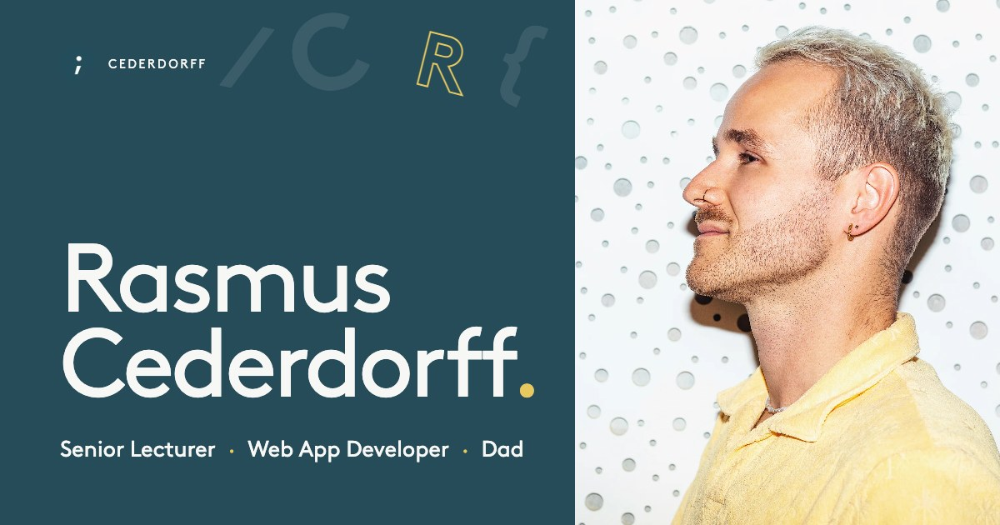

# cederdorff.com

The source for [cederdorff.com](https://cederdorff.com), my personal site. I am a senior lecturer at Business Academy Aarhus, where I teach JavaScript and web development, and I build websites and apps on the side. The site shows both.



## What is on the page

- **Hero** with a code panel you can actually use. Changing a value in `race.js` changes the accent colour of the whole page, the number of floating glyphs, or switches gravity on so they fall into a pile. The glyphs are drawn on a canvas and move away from the cursor.
- **About**, with a small mark that cycles through what I am.
- **Teaching**: how I run a lesson, and a list of the repos I use in class, filtered by technology.
- **Work**: recent projects and a few older ones.
- **Contact**, and a separate [/links](https://cederdorff.com/links) page for sharing.

## Built with

React 19, React Router and Vite. Plain CSS, no UI library and no animation library. The font is Brown.

## Run it locally

```bash
npm install
npm run dev
```

| Command | What it does |
| --- | --- |
| `npm run dev` | Starts the dev server |
| `npm run build` | Builds the site into `dist/` |
| `npm run preview` | Serves the built site |
| `npm run lint` | Runs ESLint |

## How the code is organised

```
src/
  pages/        Home and Links
  components/   one folder per section of the page:
                hero, about, teaching, work, contact
                plus layout (nav and footer), links and ui
  styles/       one stylesheet per section, imported in order from index.css
  data/         the content that changes most: projects, teaching repos,
                and the settings for the hero code panel
  hooks/        which section the nav highlights, and the scroll reveal
public/         files served as they are: images, og.jpg, the CV, manifest
```

Most content edits happen in `src/data`:

- `projects.js` holds the projects under Recent work and the links under Earlier work.
- `teaching.js` holds the teaching repos and their topics. A repo can have more than one topic.
- `playground.js` holds the accent colours and limits for the hero code panel.

A few conventions:

- Project images are 2400×1525 WebP, with a 1200px version next to each named `-1200.webp`. The page picks between them.
- Colours, the page gutter and the accent are custom properties in `src/styles/base.css`. The two blue-greens come from my style guide; everything grey is a tint of them.
- Motion respects `prefers-reduced-motion`: the glyphs are drawn once and nothing moves by itself.

## Deploy

Pushing to `main` runs `.github/workflows/static.yml`, which builds the site and publishes it to GitHub Pages on cederdorff.com. The workflow also copies `index.html` to `404.html` and `links.html`, so the client-side routes work when opened directly.

## Use it

You are welcome to read the code and borrow ideas for your own portfolio. The photos, the logo and the text are mine, and the Brown font is licensed, so please replace those.
